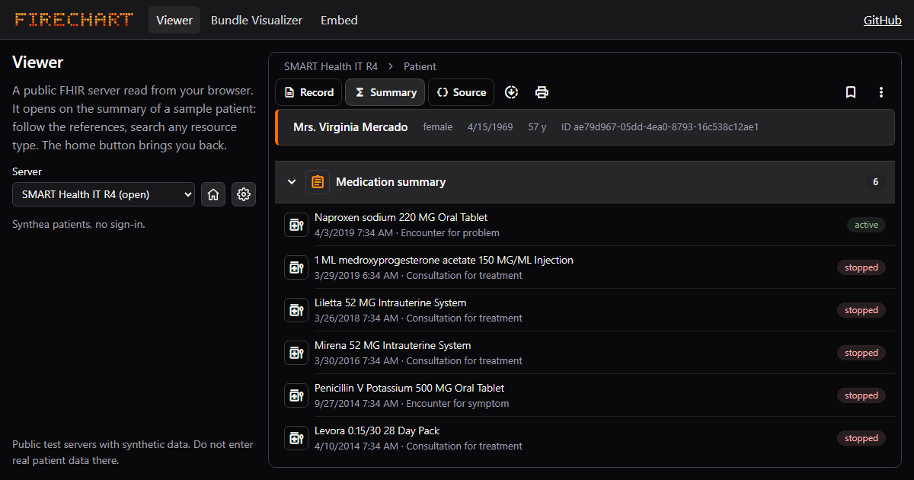
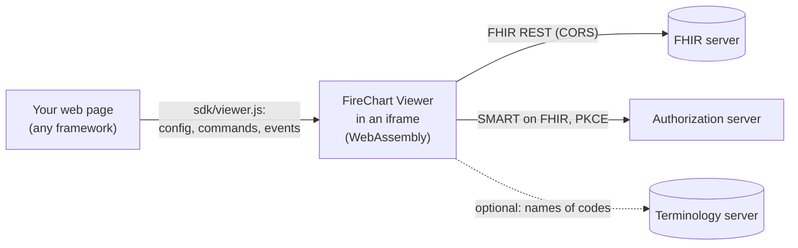

# FireChart FHIR® Viewer

[](https://github.com/firechart/viewer/actions/workflows/ci.yml)
[](https://github.com/firechart/viewer/releases/latest)
[](LICENSE)

**FHIR® records in the browser, inside your application.** FireChart Viewer reads a FHIR® server straight from the browser and shows what it
holds: the resource types of the server, searchable lists, each resource as a readable card or as its source, and the **summary of a patient**
(problems, medications, allergies, results, encounters) on one page. The **Bundle Visualizer** draws a FHIR® Bundle as the graph of the
references between its resources. Both are read-only, sign in with SMART on FHIR and embed in any web page with one script.

**SMART on FHIR support:** SMART App Launch with PKCE, by redirect or in a popup (works inside an iframe), with patient context
(`launch/patient`): a protected server opens as well as an open one. Try it with the SMART Health IT launcher in the
[demo](https://firechart.github.io/viewer/viewer.html?server=smart-launcher).

**Live demo:** <https://firechart.github.io/viewer/>: the
[Viewer](https://firechart.github.io/viewer/viewer.html) and the [Bundle Visualizer](https://firechart.github.io/viewer/bundle.html) on public test servers
with synthetic patients, and the [playground](https://firechart.github.io/viewer/playground) of every option with the code to copy.



## What is in it

| Part | What it is |
|---|---|
| **Viewer** | Browses one FHIR® server: resource types, lists with FHIR® search (forms generated from the specification), a resource with its references, the patient summary |
| **Bundle Visualizer** | A Bundle (pasted, opened from a file or read by a search) as the graph of its references; a tap opens the card and the source of a resource |
| **JavaScript SDK** | One ES module with TypeScript types (`sdk/viewer.js`): puts the Viewer or the Visualizer into your page in an iframe and drives it with events and promises |
| **Blazor components** | `<FhirViewer>` and `<FhirBundleVisualizer>` for Blazor WebAssembly and .NET MAUI Blazor Hybrid applications |
| **Component library** | `library/`: how each resource type looks, as XML components bound to FHIR® data by FHIRPath; the summary and search forms, the themes, the texts in six languages. Replace any file with your own |
| **Docker image** | `ghcr.io/firechart/viewer`: the whole site (home page, demos, playground, the frames, the SDK) as static files behind nginx |

## Platform

- **.NET 11 and Blazor WebAssembly**, the Firely .NET SDK for FHIR® (STU3, R4, R4B, R5, R6), Blazor Blueprint for the UI. No server code: the
  publish is static files that any web server can serve.
- **Browsers:** current Chrome, Edge, Firefox and Safari, desktop and mobile. The first visit downloads about 13 MB (compressed) and is cached after.
- **Languages:** English, German, Spanish, Hebrew (right to left), Russian, Chinese. Light and dark themes.
- **License:** MPL-2.0, for open and closed applications alike.

## How it works



- The Viewer runs in the browser and talks to the FHIR® server directly. **Patient data and access tokens never pass through a server of the
  Viewer or of your page**, and the Viewer keeps no database. It only reads.
- Your page talks to the frame by `postMessage` through the SDK. The frame obeys only the origins listed in its `host.json`.
- Each resource is drawn by a component of the library (`components/{Type}.view.xml`, `.tile.xml`, `.summary.xml`, ...), checked before it is
  shown; a type without a component gets a generic view. The summary of a patient is a set of parallel searches, one per section.
- A Bundle shown in the Visualizer stays in the browser; nothing the Bundle lacks is read from a server.

## Embed it

**1. Serve it.** Run the image, or copy the published files (`dotnet publish src/FireChart.Viewer.App -c Release -o out`, then `out/wwwroot`)
to any static web server or a folder of one: every address in it is relative. The server answers the addresses of the application
(`/embed`, `/playground`, ...) with `index.html`, or serves a copy of it as `404.html`, as GitHub Pages does here.

```bash
docker run -d -p 8080:8080 \
  -v "$PWD/viewer.json:/usr/share/nginx/html/viewer.json:ro" \
  -v "$PWD/host.json:/usr/share/nginx/html/host.json:ro" \
  ghcr.io/firechart/viewer:latest
```

- `host.json`: the origins of the pages that may drive the frame, `{ "frameAncestors": ["'self'", "https://emr.example.org"] }`. The image
  allows any page (`*`) so a first try works; for real data list your origins.
- `viewer.json`: the configuration of a frame used without the SDK (below). Both are read at every load: a change needs no restart.
- In front of it: HTTPS, and CSP `frame-ancestors` with the same list as `host.json`. The FHIR® server must allow the origin of the Viewer (CORS).

**2. Put it into your page.** With the SDK (the examples use the public demo, which accepts any page; serve your own for real data):

```html
<div id="viewer" style="height: 80vh"></div>
<script type="module">
  import { Viewer } from "https://firechart.github.io/viewer/sdk/viewer.js";

  const viewer = Viewer.create(
    { server: { url: "https://r4.smarthealthit.org" }, appearance: { theme: "inherit" }, locale: "inherit" },
    { url: "https://firechart.github.io/viewer/", urlParam: "fhir" }
  ).mount("#viewer");

  viewer.on("navigate", e => console.log("now at", e.location));
  await viewer.navigate("summary/Patient/13a00221-8417-4973-961e-e21b32ece95a");
</script>
```

The Bundle Visualizer, from the same module:

```js
import { BundleVisualizer } from "https://firechart.github.io/viewer/sdk/viewer.js";

const bundles = BundleVisualizer.create({ appearance: { theme: "auto" } }, { url: "https://firechart.github.io/viewer/" }).mount("#graph");
await bundles.show(bundleJsonOrXmlOrObject);          // or { location: "Encounter?_count=5&_include=Encounter:patient" } with a server
```

Without JavaScript, a plain frame shows the server of `viewer.json`: `<iframe src="https://firechart.github.io/viewer/embed" style="width:100%;height:800px;border:0"></iframe>`.

Components for **React, Angular and Vue** (a dozen lines each), recipes and troubleshooting: [HOWTO](src/FireChart.Viewer.App/Sdk/HOWTO.md).
Every member of the SDK: [SDK README](src/FireChart.Viewer.App/Sdk/README.md). Working pages: [`samples/`](samples).

**3. SMART on FHIR** (a server that needs a sign-in): add `smart` to the configuration and register both redirect URIs of your instance at the
authorization server, `<instance>/smart/callback` and `<instance>/_content/FireChart.Viewer/smart-callback.html`. In a frame use
`"flow": "popup"`: many authorization servers refuse to be framed. To test, point `server.url` at the SMART App Launcher
(`https://launch.smarthealthit.org/v/r4/fhir`, any client id, `"extraParameters": "launch=e30"`). Details:
[SMART sign-in](src/FireChart.Viewer/README.md#smart-sign-in).

**In a Blazor application** render the component instead of a frame:

```razor
@page "/viewer/{*Path}"
<FhirViewer Server="_server" RoutePrefix="viewer/" />
```

Setting up the host (references, services, styles, the SMART callback): [the README of the component](src/FireChart.Viewer/README.md).

## Configuration

The same object is `viewer.json` of an instance and the `config` of the SDK. Only `server.url` is required; JSON with comments is accepted.

```json
{
  "server": { "url": "https://fhir.example.org/r4", "name": "Our FHIR server" },
  "smart": { "clientId": "viewer", "scopes": "openid fhirUser launch/patient patient/*.rs", "flow": "popup" },
  "locale": "auto",
  "fhir": { "terminologyServer": "https://tx.fhir.org/r4" },
  "appearance": { "theme": "auto", "style": "fluent", "variables": { "colorPrimary": "#0a7f5a" } }
}
```

| Key | Meaning |
|---|---|
| `server.url`, `.name`, `.fhirRelease`, `.pageSize`, `.timeoutSeconds` | The FHIR® API (required); its name in the breadcrumbs; the release when `/metadata` does not say it; resources per page (50); seconds per request (60) |
| `smart.clientId`, `.scopes`, `.flow`, `.authority`, `.extraParameters` | A public SMART client with PKCE (no secret); `redirect` (default) or `popup`; the OpenID authority when SMART discovery does not find it; more parameters of the request |
| `locale` | `auto`, `en`, `de`, `es`, `he`, `ru`, `zh-Hans` (a region may follow: `de-AT`); in the SDK also `inherit` (the `lang` of your page) |
| `fhir.terminologyServer`, `.pageSize`, `.loadAll`, `.decimals` | Words for bare codes (none: codes as they are); records per search of a summary (20); load a whole summary first (on; `false` draws each section as it comes); decimal places (2) |
| `appearance.theme`, `.style`, `.fonts`, `.variables`, `.rules` | `light`, `dark`, `auto` (in the SDK also `inherit`); a theme of the library (`fluent`, `compact` or your own); fonts, tokens (`colorPrimary`, `fontFamily`, `borderRadius`, ...) and rules for `.Banner`, `.Tile`, `.Badge`, `.Card`, `.Table` |

A wrong key or value stops the Viewer with its path and a hint (`'apperance' is not an option. Did you mean 'appearance'?`).

**Your own look and components.** A folder mounted at `/usr/share/nginx/appearance` goes over the library file by file: a theme
(`styles/themes/acme.css`, chosen with `"style": "acme"`), a component (`components/Patient.tile.xml`), a summary or a search form.

**Addresses inside the Viewer** (after `embed/`, in `navigate()`, below the `RoutePrefix` of the component): `resources` (the resource
types), `resources/Observation?code=8867-4&patient=123` (a list with a FHIR® search), `resources/Patient/123` (a resource),
`summary/Patient/123` (the summary of a patient).

## Build and repository layout

```bash
dotnet build FireChart.Viewer.slnx
dotnet test FireChart.Viewer.slnx --filter "TestCategory!=Browser"   # the browser tests need Chrome or Edge
dotnet run --project src/FireChart.Viewer.App                          # the site and the playground, F5 in an IDE
docker build -t firechart-viewer:local .                              # the image as GitHub builds it
sh docker/smoke.sh firechart-viewer:local                              # its smoke test
```

| Folder | What it is |
|---|---|
| `src/FireChart.Viewer`, `.Viewer.Core`, `.Viewer.Library` | The components, the engine (FHIR® client per release, components, FHIRPath, SMART), the readers of the library |
| `src/FireChart.Viewer.App` | The site: home page and demos (`wwwroot/*.html`), the playground, the frames `embed` and `embed-bundle`, the SDK (`wwwroot/sdk`) |
| `src/Flox.*`, `src/FireChart.Resources` | The client side of the Flox platform the Viewer is built on, and the texts |
| `src/FireChart.FhirMetadata` | Writes the FHIR® metadata of the core releases into the engine |
| `library/`, `samples/`, `test/` | The component library, pages that use the SDK, the unit tests |

A push to `main` builds and tests, publishes the image for the version in `VERSION` (`linux/amd64`, `linux/arm64`, with provenance and an
SBOM), tags the release with its notes from `CHANGELOG.md` and puts the site on GitHub Pages (`.github/workflows/ci.yml`).

## License and trademarks

[MPL-2.0](LICENSE): use the Viewer in open and closed applications; changes to the files of this repository that you distribute are published
under MPL-2.0 ([NOTICE](NOTICE)). Contributions will be accepted under a Contributor License Agreement, which is being prepared: until then,
please open an issue. The license grants no rights to the name FireChart or its logos. FHIR® is the registered trademark of Health Level Seven
International (HL7), used with its permission. Third-party components keep their own licenses, listed on the About page of the application.
FireChart Viewer is not a medical device: it displays data of other systems.
